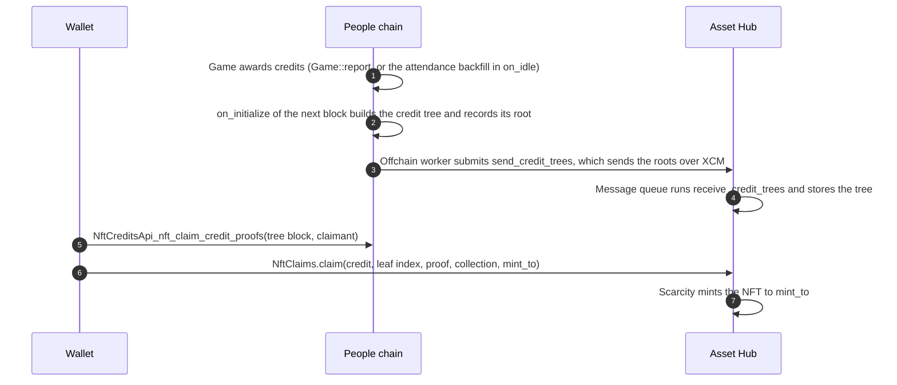
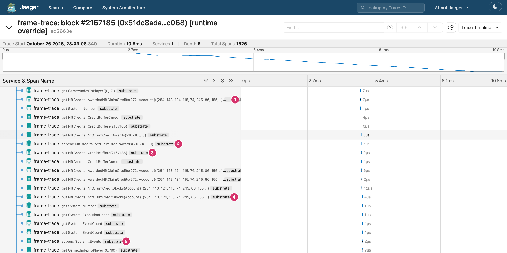
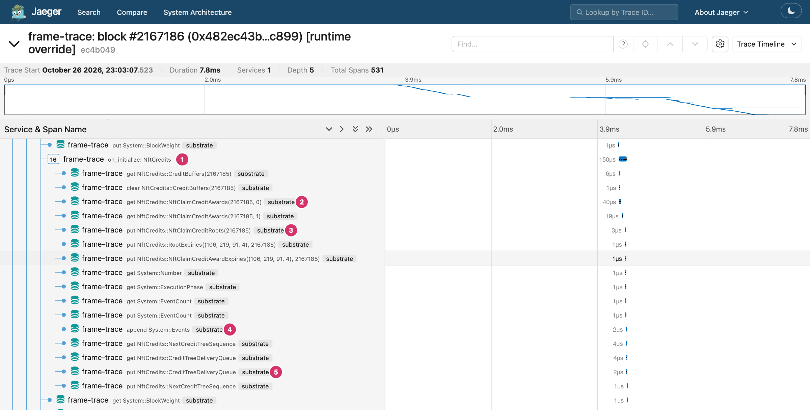
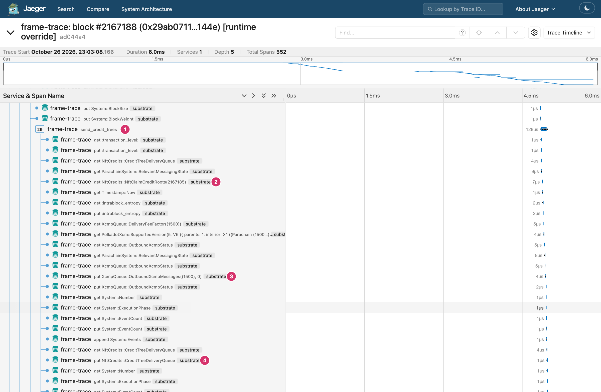
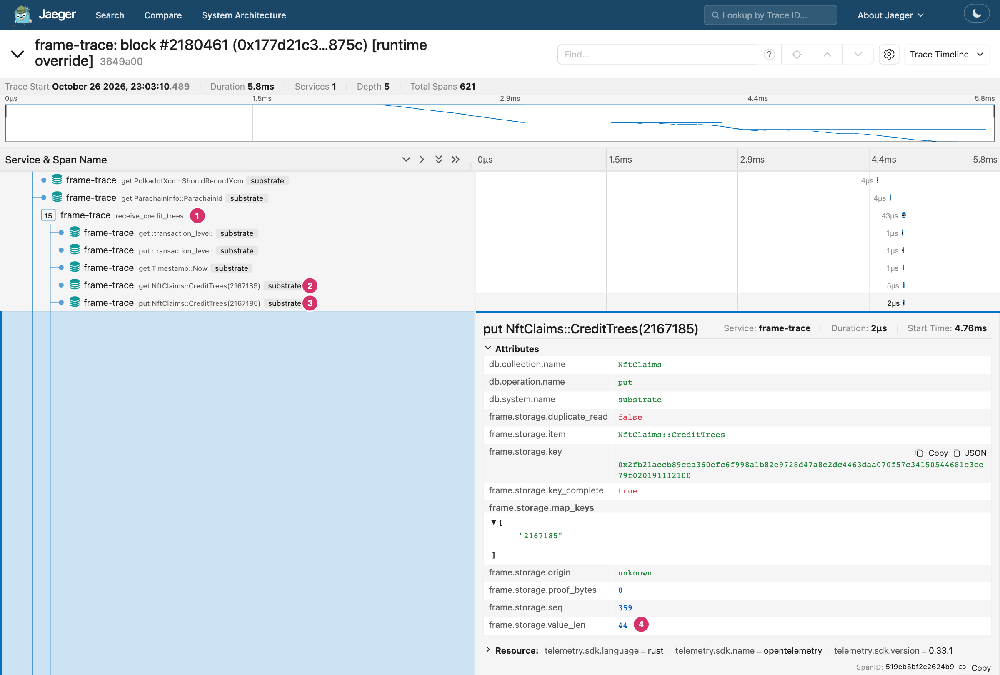
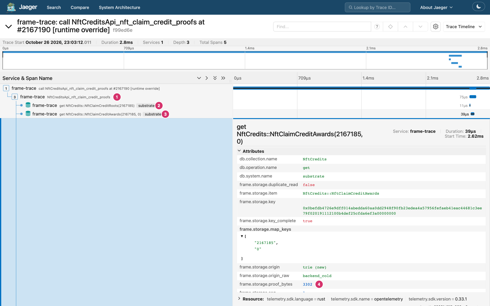
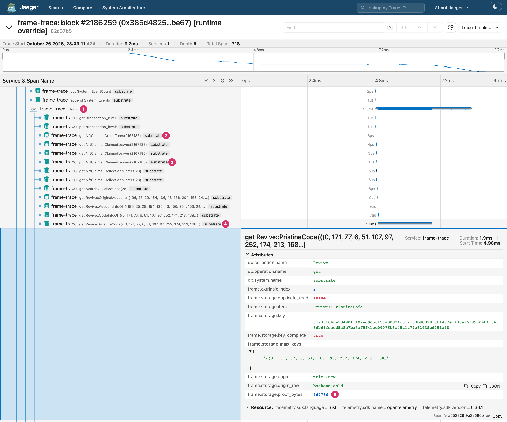

# NFT minting progress

This page is for wallets and products that show a user how far their NFT is from being minted.
It lists the stages a credit goes through, what a chain observer can read at each stage, the gaps and what to build on top.
Every number on this page comes from a replay of real blocks on the People Next and Asset Hub Next devnets with [frame-trace](https://github.com/agustinustheo/frame-trace).
[Reproduce the traces](#reproduce-the-traces) lists the commands.

## The stages

A user earns NFT claim credits on the People chain by playing games.
The People chain commits the credits of one block to one Merkle tree and sends the tree's root to Asset Hub over XCM.
On Asset Hub the user claims a credit with a Merkle proof, and the claim mints the NFT.
Nothing mints by itself: the last step is a transaction the user signs.



| # | Stage | Chain | Runs in | Storage that changes | Event |
| --- | --- | --- | --- | --- | --- |
| 1 | Credit awarded | People | `Game::report`, or `on_idle` of `Game` for the attendance backfill | `NftCredits::NftClaimCreditAwards`, `CreditBuffers`, `CreditBufferCursor`, `AwardedNftClaimCredits`, `NftClaimCreditBlocks` | `NftCredits::NftClaimCreditAwarded { claimant, credit, block, leaf_index }` |
| 2 | Root committed | People | `on_initialize` of `NftCredits` in the next block | `NftCredits::NftClaimCreditRoots`, `CreditTreeDeliveryQueue`, `NextCreditTreeSequence`, `RootExpiries`, `NftClaimCreditAwardExpiries` | `NftCredits::NftClaimCreditRootRecorded { block, credit_root }` |
| 3 | Root sent | People | `NftCredits.send_credit_trees`, submitted by the offchain worker | `NftCredits::CreditTreeDeliveryQueue`, `XcmpQueue::OutboundXcmpMessages` | `NftCredits::CreditTreesSent { trees }` |
| 4 | Root received | Asset Hub | `NftClaims.receive_credit_trees`, run by the message queue | `NftClaims::CreditTrees`, `TreeExpiries`, `NextExpectedSequence` | `NftClaims::CreditTreesReceived { count, stored }` |
| 5 | Proof fetched | People | Runtime API `NftCreditsApi_nft_claim_credit_proofs`, read only | None | None |
| 6 | Claimed and minted | Asset Hub | `NftClaims.claim`, signed by the user | `NftClaims::ClaimedLeaves`, `Scarcity::Instances`, `NftsByOwner`, `NextInstanceId`, `ItemDefs`, `Collections` | `NftClaims::CreditClaimed { block, leaf, collection, item, owner, instance }`, `Scarcity::Minted` |

The `block` in `NftClaimCreditAwarded` is the tree block: the block whose tree commits the credit.
It is the award block unless that block's buffer of 2048 credits is full.
Then the credit goes into the buffer of a later block, up to 8 blocks ahead.
Every later stage names the tree by this block number.

## One credit, traced

Tree 2167185 on People Next holds 41 credits.
These are the blocks of its journey.
Each block was replayed with the `v0.3.4` runtimes built with the `with-tracing` feature, and each replay reproduced the block's state root.

| # | Stage | Block | Time (UTC) | Phase | Storage operations | Proof bytes |
| --- | --- | --- | --- | --- | --- | --- |
| 1 | Credits awarded | People #2167185 | 2026-10-23 13:03:00 | finalization | 1171 | 37,704 |
| 2 | Root committed | People #2167186 | 13:03:00 | initialization | 167 | 10,456 |
| 3 | Root sent | People #2167188 | 13:03:00 | extrinsic 2 | 60 | 4,036 |
| 4 | Root received | Asset Hub #2180461 | 13:03:24 | finalization | 138 | 9,235 |
| 5 | Proof fetched | People at #2167190 | | runtime API call | 3 | 6,103 |
| 6 | Claimed and minted | Asset Hub #2186259 | 16:19:48 | extrinsic 2 | 149 | 192,494 |

The figures are for the whole phase, so phases 1, 2 and 4 include work from other pallets in the same phase.

### How long each stage takes

The table below samples 39 of the 503 trees that People Next had recorded on 2026-10-26, from tree block 46062 to 2296191.
They are 25 evenly spaced trees plus every fifth tree with a claim, so the claim figures over-represent claimed trees.
People Next makes several blocks in one 6-second slot, and they share a timestamp, so a People wait of 0 s means the same slot.

| Wait | Fastest | Median | Slowest |
| --- | --- | --- | --- |
| Root recorded to root sent | 1 block, 0 s | 1 block, 0 s | 2 blocks, 12 s |
| Root sent to tree stored on Asset Hub | 12 s | 24 s | 48 s |
| Tree stored to first claim (18 trees with a claim) | 1 minute | 20.6 hours | 18.3 days |

Every sampled tree reached Asset Hub, and none waited in the delivery queue for more than 2 blocks.
The wait a user sees is the claim: 66 of the 783 sampled credits are claimed.

### 1. Credits awarded



The Game pallet's attendance backfill for game 272 runs in `on_idle`, so its work is in the block's finalization phase.
FRAME emits no span for `on_idle`, so the storage operations sit directly under `finalization`.

1. `AwardedNftClaimCredits(272, claimant)` marks which of the claimant's credits game 272 has awarded already, so no credit is awarded twice.
2. The credit is appended to chunk 0 of the tree block's awards. A chunk holds 32 awards, so this tree's 41 credits fill chunk 0 and part of chunk 1.
3. `CreditBuffers(2167185)` holds the award count of the tree block's buffer. When the buffer is full, `CreditBufferCursor` moves later credits to a later block.
4. `NftClaimCreditBlocks(claimant)` records the tree block in the claimant's list. A wallet reads this list to find the claimant's trees.
5. The `NftClaimCreditAwarded` event. A wallet that follows events learns here the tree block and the leaf index of the credit.

The finalization phase awards 41 credits and adds 37.7 KB to the block's proof, less than 1 KB a credit.

### 2. Root committed



1. `on_initialize` of `NftCredits` builds the tree of the previous block's buffer.
2. It reads the awards back, chunk by chunk, to compute the root.
3. `NftClaimCreditRoots(2167185)` stores the root, the leaf count and the time. The value is 44 bytes.
4. The `NftClaimCreditRootRecorded` event.
5. The tree joins `CreditTreeDeliveryQueue` with the next sequence number.

From here the credit is committed on the People chain.
A wallet can call `NftCreditsApi_nft_claim_credit_roots` for the claimant and see this tree in the result.

### 3. Root sent



The offchain worker submits `send_credit_trees` as an authorized transaction, so the transaction appears in the block like any other extrinsic.

1. The `send_credit_trees` call.
2. It reads the root of each queued tree.
3. It writes the XCM message for para 1500 to `XcmpQueue::OutboundXcmpMessages`.
4. It removes the sent trees from the front of `CreditTreeDeliveryQueue`.
5. The `CreditTreesSent { trees }` event, which names tree 2167185.

The tree was sent two blocks after its root was recorded.

### 4. Root received



The XCM message arrives on Asset Hub and the message queue runs it during finalization.

1. The message's `Transact` dispatches `receive_credit_trees` with the People chain's sibling origin.
2. It checks that the tree is not stored yet.
3. It stores the tree under its People block number, `CreditTrees(2167185)`.
4. The stored value is the same 44 bytes the People chain recorded.

From this block the credit is claimable.
`CreditTreesReceived { count, stored }` gives counts only, so a wallet confirms its own tree with a read of `NftClaims::CreditTrees(tree block)`.

### 5. Proof fetched



The wallet asks the People chain for the proof of each credit the claimant holds in the tree.
This is a read-only runtime API call, so it costs no fee and is not in a block.

1. The runtime API call, made at People block #2167190.
2. It reads the root to check the tree exists.
3. It reads the tree's two award chunks.
4. The first chunk adds 3.3 KB to the call's proof. The whole call reads 6.1 KB.

The result holds the credit, its leaf index and the sibling hashes.
The node's own `state_call` returns the same bytes.

### 6. Claimed and minted



The user signs `NftClaims.claim` on Asset Hub with the proof.
This claim came 3 hours and 16 minutes after the tree arrived.

1. The `claim` call.
2. It reads the tree root from `CreditTrees(2167185)` to check the proof.
3. It sets the leaf's bit in `ClaimedLeaves(2167185)`.
4. Collection 28 registers a minter contract, so `claim` calls the contract to select the item. That call reads the contract's code, `Revive::PristineCode`.
5. The code read adds 167,786 bytes to the proof. It is 87% of the claim's 192,494 bytes.

The mint then writes `Scarcity::Instances` and `Scarcity::NftsByOwner(mint_to)`.
The claim emits `CreditClaimed { block, leaf, collection, item, owner, instance }` and `Scarcity::Minted`.
`owner` is the `mint_to` account, not the claimant.

## Track a credit as a wallet

A wallet can follow a claimant's credits with the events and storage that exist today.
The state names in the first column are suggestions for the user interface.

| State shown to the user | How to detect it | Chain |
| --- | --- | --- |
| Earned | An `NftCredits::NftClaimCreditAwarded` event for the claimant. Keep its `block` (the tree block) and `leaf_index`. | People |
| Committed | An `NftCredits::NftClaimCreditRootRecorded` event for that `block`, or `NftCredits::NftClaimCreditRoots(block)` exists. | People |
| Sending | `block` is in an `NftCredits::CreditTreesSent { trees }` event. | People |
| Claimable | `NftClaims::CreditTrees(block)` exists. | Asset Hub |
| Claimed | The bit `leaf_index` of `NftClaims::ClaimedLeaves(block)` is set: byte `leaf_index / 8`, bit `leaf_index % 8`. | Asset Hub |
| Minted | An `NftClaims::CreditClaimed { block, leaf }` event. Its `instance` and `owner` name the NFT. | Asset Hub |

A wallet that starts late, or misses events, rebuilds the list from storage:

1. Read `NftCredits::NftClaimCreditBlocks(claimant)` on People for the claimant's tree blocks.
2. Call `NftCreditsApi_nft_claim_credit_roots(claimant)` for the blocks that have a root.
   A block in the first list but not here is a tree still waiting for its root: the credit is earned but not committed.
3. For each block with a root, read `NftClaims::CreditTrees(block)` and `NftClaims::ClaimedLeaves(block)` on Asset Hub.
4. Call `NftCreditsApi_nft_claim_credit_proofs(block, claimant)` for the proofs of the credits that are not claimed.

`AccountOrPerson` keys these calls.
A credit earned as a person is keyed by the person's alias, and `claim` takes `ClaimantKind::Person` to resolve it.

## Gaps

These are the places where a wallet cannot tell the user what is happening, or has to work it out itself.

1. **No status call.**
   No runtime API returns the state of a claimant's credits.
   A wallet combines two People reads, one People runtime API, two Asset Hub reads and a bitmap decode.
2. **No claimed check.**
   No runtime API answers "is this leaf claimed?".
   `Pallet::leaf_is_claimed` exists in `nft-claims` but no API exposes it, so a wallet decodes the `ClaimedLeaves` bitmap itself.
   `NftClaimsApi_preview_mints` does not report a claimed leaf or a missing tree either.
3. **Arrival is not named.**
   `CreditTreesReceived { count, stored }` gives counts and no blocks.
   To see that its tree arrived, a wallet polls `NftClaims::CreditTrees(block)` on Asset Hub.
   The People chain never learns that a tree arrived.
4. **The delivery queue is silent.**
   A tree waits in `CreditTreeDeliveryQueue` until the offchain worker sends it.
   No event reports the wait, only `CreditTreeDeliveryDropped` when the queue is full.
   `CreditTreesSent` names blocks but not sequences, and `CreditTreesMissing` on Asset Hub names sequences but not blocks.
   So a lost delivery is hard to connect to a user's tree.
5. **Credits earned later.**
   A `Person` vote in `Game::report` awards its credit at once.
   The rest of a game's credits come from the attendance backfill during the PlayerProcess state, in `on_idle`.
   No event says the backfill is pending or how many credits to expect.
6. **No link from credit to NFT in storage.**
   The NFT goes to `mint_to`, a key the user chooses.
   Only the `CreditClaimed` event connects the credit to the instance.
   A wallet that missed the event cannot find the NFT from the credit.
7. **Pruned data.**
   After `AwardRetentionTtl` (90 days) the awards are deleted, and `nft_claim_credit_proofs` returns `AwardsPruned`.
   The wallet then rebuilds the proof from old `NftClaimCreditAwarded` events with `nft_claim_credit_proof_from_awards`.
   `NftClaimCreditBlocks` keeps the last 256 tree blocks per claimant, so a busy claimant's oldest blocks are only in events.
   `CreditAwardsExpired`, `CreditTreesExpired` and `CreditRootsExpired` give counts and no blocks.

## Recommendations

For wallet and product teams, with the runtime as it is:

- Follow `NftClaimCreditAwarded` on People and `CreditClaimed` on Asset Hub, and poll `NftClaims::CreditTrees(block)` between them.
  Store the `CreditClaimed` event, because it is the only link from a credit to its NFT.
- Expect the chains to move fast. In every sampled tree, the root reached Asset Hub within a minute of the award.
  A tree that is not on Asset Hub after a few minutes is stuck. Show it as delayed, not as pending.
- Fetch proofs from the runtime API, not from storage. The call reads a few KB and needs no fee.

For the runtime, in order of value to a wallet:

1. Add a People view function or runtime API, `credit_status(claimant)`, that returns each tree block with its state: buffered, committed, queued at sequence `n` or sent.
2. Add an Asset Hub view function or runtime API, `claim_status(block, leaf)`, that returns whether the tree is stored, whether the leaf is claimed and the tree's expiry.
3. Name the blocks in `CreditTreesReceived`, as `CreditTreesSent` does.
4. Name the blocks in the expiry events.
5. Store the instance a leaf minted, or add the claimant to `CreditClaimed`, so that the NFT is found from the credit.

The claim's proof size is a separate finding.
With a contract minter, every claim reads the whole contract code, 167,786 bytes for collection 28.
That fits the selector's 512 KiB proof ceiling, but it makes each claim cost about 190 KB of the block's proof budget.
A collection that selects items with `ItemSelection::Random` avoids the read.

## Reproduce the traces

Install frame-trace and start Jaeger, as in [its getting-started guide](https://agustinustheodorus.com/frame-trace/getting-started/reading-a-trace.html):

```sh
git clone https://github.com/agustinustheo/frame-trace
cargo install --locked --path frame-trace/crates/cli
docker run -d --rm --name jaeger -p 16686:16686 -p 4318:4318 jaegertracing/jaeger:latest
```

Both devnets ran the `v0.3.4` runtimes for these blocks.
Build them with call and hook spans from that tag.
`with-tracing` only adds spans, and the root check confirms the build reproduces each block.
The release workflow sets `spec_version` to `3_004_000` after it tags, so set it in the source too, or signed transactions fail `CheckSpecVersion`:

```sh
git worktree add --detach ../v0.3.4-traced v0.3.4
cd ../v0.3.4-traced
# Add this line under [features] in both runtimes' Cargo.toml:
#   with-tracing = ["frame-executive/with-tracing", "sp-io/with-tracing"]
sed -i '' 's/spec_version: 3_003_000,/spec_version: 3_004_000,/' runtimes/next-*/src/lib.rs
cargo build --release -p next-people-paseo-runtime -p next-asset-hub-paseo-runtime \
  --features next-people-paseo-runtime/with-tracing,next-asset-hub-paseo-runtime/with-tracing
```

Replay each stage into Jaeger:

```sh
PEOPLE=wss://paseo-people-next-system-rpc.polkadot.io
AH=wss://paseo-asset-hub-next-rpc.polkadot.io
PW=target/release/wbuild/next-people-paseo-runtime/next_people_paseo_runtime.compact.compressed.wasm
AW=target/release/wbuild/next-asset-hub-paseo-runtime/next_asset_hub_paseo_runtime.compact.compressed.wasm

frame-trace block --rpc $PEOPLE --block 2167185 --runtime-override $PW --otlp   # 1. credits awarded
frame-trace block --rpc $PEOPLE --block 2167186 --runtime-override $PW --otlp   # 2. root committed
frame-trace block --rpc $PEOPLE --block 2167188 --runtime-override $PW --otlp   # 3. root sent
frame-trace block --rpc $AH --block 2180461 --runtime-override $AW --otlp       # 4. root received
frame-trace call --rpc $PEOPLE --at 2167190 --method NftCreditsApi_nft_claim_credit_proofs \
  --data 0x91112100<claimant> --runtime-override $PW --otlp                     # 5. proof fetched
frame-trace block --rpc $AH --block 2186259 --runtime-override $AW --otlp       # 6. claimed and minted
```

`0x91112100` is tree block 2167185 as a little-endian `u32`, and `<claimant>` is the SCALE-encoded `AccountOrPerson`.
The claimant of the traced proof is `0x00fe8f7c734af5569b45dfd69d2bcdc6f4f9d94c43e4d39d55b280265e70dce51a`.
Without `--runtime-override`, the replays show the same storage operations without the call and hook spans.
`frame-trace summary` with the same flags prints the per-phase tables.
