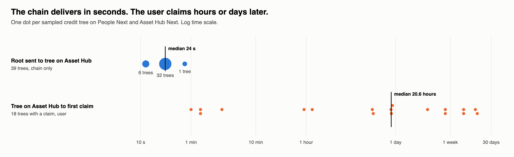
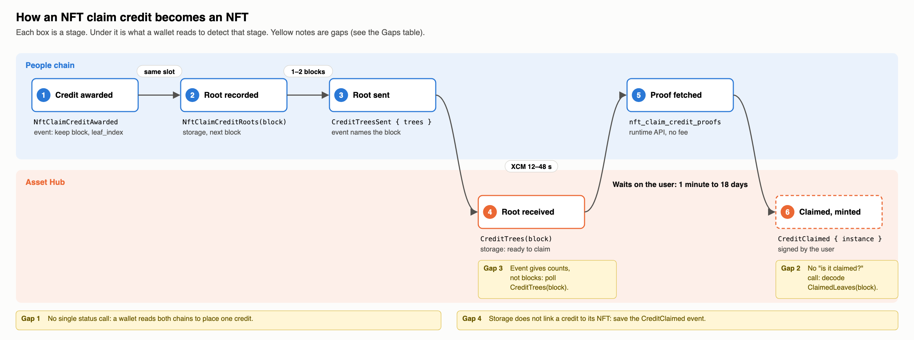
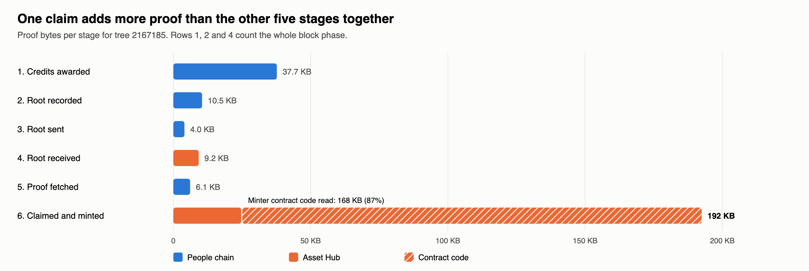

# NFT minting progress

How a wallet or product can show a user how far their NFT is from being minted.
This page answers [#202](https://github.com/paritytech/individuality-community/issues/202): how it works today, the gaps, the process and advice for the teams that build it.

The figures come from real blocks on the People Next and Asset Hub Next devnets, replayed with [frame-trace](https://github.com/agustinustheo/frame-trace).

## Summary

- **A wallet can track progress today** from existing events and storage. It needs reads on both chains and one runtime API call. [How to track a credit](#how-to-track-a-credit) lists them.
- **The chains are fast.** In 39 sampled trees, a credit's root reached Asset Hub 12 to 48 seconds after it was sent. A tree that is not on Asset Hub after a few minutes is stuck.
- **The long wait is the user.** Nothing mints by itself: the user must sign `NftClaims.claim`. The first claim on a tree came from 1 minute to 18 days after the tree arrived.
- **The main gaps:** no single call returns a credit's status, no call answers "is this credit claimed?" and storage does not link a credit to the NFT it minted.



## How minting works

A user earns credits on the People chain by playing games.
The People chain puts the credits of one block in a Merkle tree and sends the tree's root to Asset Hub over XCM.
The user then claims each credit on Asset Hub with a Merkle proof, and the claim mints the NFT.



The table gives the full signal for each stage.

| # | Stage | Chain | What a wallet sees |
| --- | --- | --- | --- |
| 1 | Credit awarded | People | Event `NftCredits::NftClaimCreditAwarded { claimant, credit, block, leaf_index }` |
| 2 | Root recorded, in the next block | People | Event `NftClaimCreditRootRecorded { block }`. Storage `NftClaimCreditRoots(block)` |
| 3 | Root sent to Asset Hub | People | Event `CreditTreesSent { trees }`, which names `block` |
| 4 | Root received | Asset Hub | Storage `NftClaims::CreditTrees(block)`. The event `CreditTreesReceived` gives only counts |
| 5 | Proof fetched | People | Runtime API `NftCreditsApi_nft_claim_credit_proofs(block, claimant)`. No fee |
| 6 | Claimed and minted | Asset Hub | Event `NftClaims::CreditClaimed { block, leaf, instance, owner }`. Storage `ClaimedLeaves(block)` |

`block` is the **tree block**: the block whose tree holds the credit.
Every stage uses it, so a wallet keeps it from the first event.
It is the block of the award, unless that block already holds 2048 credits. Then the credit goes to a later block, at most 8 blocks later.

## How to track a credit

| Show the user | Condition | Chain |
| --- | --- | --- |
| Earned | `NftClaimCreditAwarded` for the claimant. Keep `block` and `leaf_index`. | People |
| Committed | `NftClaimCreditRoots(block)` exists. | People |
| On its way | `block` is in a `CreditTreesSent` event. | People |
| Ready to claim | `NftClaims::CreditTrees(block)` exists. | Asset Hub |
| Claimed | Bit `leaf_index` of `NftClaims::ClaimedLeaves(block)` is set: byte `leaf_index / 8`, bit `leaf_index % 8`. | Asset Hub |
| Minted | `CreditClaimed { block, leaf }` event. `instance` is the NFT and `owner` is the `mint_to` account. | Asset Hub |

A wallet that starts late, or misses events, rebuilds the state from storage:

1. On People, read `NftCredits::NftClaimCreditBlocks(claimant)` to get the claimant's tree blocks.
2. On People, call `NftCreditsApi_nft_claim_credit_roots(claimant)`. A block from step 1 that is not in this result is still waiting for its root.
3. On Asset Hub, read `CreditTrees(block)` and `ClaimedLeaves(block)` for each block.
4. On People, call `NftCreditsApi_nft_claim_credit_proofs(block, claimant)` for the credits that are not claimed.

The `claimant` is an `AccountOrPerson`.
For a credit earned as a person, it is the person's alias, and `claim` takes `ClaimantKind::Person`.

## Gaps

Gaps 1 to 4 are marked in the stage diagram above.

| Gap | Effect on a wallet | Possible fix |
| --- | --- | --- |
| No status call | It combines two People reads, a People runtime API call, two Asset Hub reads and a bitmap decode. | A People runtime API `credit_status(claimant)` that returns each tree block and its stage. |
| No "is it claimed?" call | It decodes the `ClaimedLeaves` bitmap itself. `NftClaimsApi_preview_mints` does not check this. | An Asset Hub runtime API `claim_status(block, leaf)`: tree stored, leaf claimed, expiry. |
| Arrival is not named | `CreditTreesReceived` gives counts, not blocks, so the wallet polls `CreditTrees(block)`. | Name the blocks in `CreditTreesReceived`. |
| No link from credit to NFT in storage | Only the `CreditClaimed` event links them. A wallet that missed the event cannot find the NFT. | Store the instance each leaf minted. |
| Lost deliveries are hard to trace | `CreditTreesSent` names blocks, but `CreditTreesMissing` names sequence numbers. | Name the blocks in both. |
| Credits that come later | Part of a game's credits come from a backfill after the game ends. No event says that credits are still to come. | An event when the backfill starts and ends. |
| Old data is deleted | After 90 days the awards are deleted and the proof call fails with `AwardsPruned`, so the wallet rebuilds the proof from old events. `NftClaimCreditBlocks` keeps only the last 256 tree blocks. The expiry events give counts, not blocks. | Name the blocks in the expiry events. |

## Advice for wallet and product teams

- Follow `NftClaimCreditAwarded` on People and `CreditClaimed` on Asset Hub. Between them, poll `NftClaims::CreditTrees(block)`.
- Save each `CreditClaimed` event. It is the only link from a credit to its NFT.
- Expect a credit to be ready to claim within a minute of the award. If it is not on Asset Hub after a few minutes, show it as delayed.
- Get proofs from the runtime API. The call is free and reads about 6 KB.
- The user must claim each credit. A reminder or a "claim all" action helps more than a faster chain.

## Evidence

### Measured wait times

39 of the 503 trees on People Next, from tree block 46062 to 2296191: 25 evenly spaced trees and every fifth tree with a claim.
The claim figures therefore over-represent claimed trees.
The wait-time chart in the [Summary](#summary) shows each tree.

| Wait | Fastest | Median | Slowest |
| --- | --- | --- | --- |
| Root recorded to root sent | 1 block | 1 block | 2 blocks |
| Root sent to tree on Asset Hub | 12 s | 24 s | 48 s |
| Tree on Asset Hub to first claim (18 trees) | 1 minute | 20.6 hours | 18.3 days |

Every sampled tree reached Asset Hub. 66 of the 783 sampled credits are claimed.

### One credit, traced

Tree 2167185 holds 41 credits.
Each block below was replayed with the `v0.3.4` runtimes, the version the devnets ran, built with `with-tracing`. Each replay reproduced the block's state root.

| # | Stage | Block | Time (UTC, 2026-10-23) | Storage operations | Proof bytes |
| --- | --- | --- | --- | --- | --- |
| 1 | Credits awarded | People #2167185 | 13:03:00 | 1171 | 37,704 |
| 2 | Root recorded | People #2167186 | 13:03:00 | 167 | 10,456 |
| 3 | Root sent | People #2167188 | 13:03:00 | 60 | 4,036 |
| 4 | Root received | Asset Hub #2180461 | 13:03:24 | 138 | 9,235 |
| 5 | Proof fetched | People, at #2167190 | | 3 | 6,103 |
| 6 | Claimed and minted | Asset Hub #2186259 | 16:19:48 | 149 | 192,494 |

Rows 1, 2 and 4 count the whole block phase, so they include work from other pallets.

### Why a claim is expensive



Collection 28 selects items with a minter contract, so each claim reads the whole contract code.
That one read is 167,786 bytes, 87% of the claim's proof.
A collection that uses `ItemSelection::Random` does not read it.

The trace of the claim shows the read:
(1) the `claim` call, (2) the tree root it checks the proof against, (3) the bit that marks the credit as claimed, (4) the read of the contract code `Revive::PristineCode` and (5) the 167,786 bytes that read adds to the proof.


### Reproduce the traces

Install [frame-trace](https://agustinustheodorus.com/frame-trace/getting-started/reading-a-trace.html) and start Jaeger:

```sh
cargo install --locked --git https://github.com/agustinustheo/frame-trace frame-trace
docker run -d --rm --name jaeger -p 16686:16686 -p 4318:4318 jaegertracing/jaeger:latest
```

Build the `v0.3.4` runtimes with tracing.
Add `with-tracing = ["frame-executive/with-tracing", "sp-io/with-tracing"]` under `[features]` in both runtimes' `Cargo.toml`.
Also set `spec_version` to `3_004_000`, as the release did, or signed transactions fail the replay.

```sh
git worktree add --detach ../v0.3.4-traced v0.3.4 && cd ../v0.3.4-traced
sed -i '' 's/spec_version: 3_003_000,/spec_version: 3_004_000,/' runtimes/next-*/src/lib.rs
cargo build --release -p next-people-paseo-runtime -p next-asset-hub-paseo-runtime \
  --features next-people-paseo-runtime/with-tracing,next-asset-hub-paseo-runtime/with-tracing
```

Replay the blocks:

```sh
PEOPLE=wss://paseo-people-next-system-rpc.polkadot.io
AH=wss://paseo-asset-hub-next-rpc.polkadot.io
PW=target/release/wbuild/next-people-paseo-runtime/next_people_paseo_runtime.compact.compressed.wasm
AW=target/release/wbuild/next-asset-hub-paseo-runtime/next_asset_hub_paseo_runtime.compact.compressed.wasm

for b in 2167185 2167186 2167188; do frame-trace block --rpc $PEOPLE --block $b --runtime-override $PW --otlp; done
for b in 2180461 2186259; do frame-trace block --rpc $AH --block $b --runtime-override $AW --otlp; done
frame-trace call --rpc $PEOPLE --at 2167190 --method NftCreditsApi_nft_claim_credit_proofs \
  --data 0x9111210000fe8f7c734af5569b45dfd69d2bcdc6f4f9d94c43e4d39d55b280265e70dce51a \
  --runtime-override $PW --otlp
```

The `--data` is tree block 2167185 as a little-endian `u32`, then the claimant as a SCALE-encoded `AccountOrPerson`.
