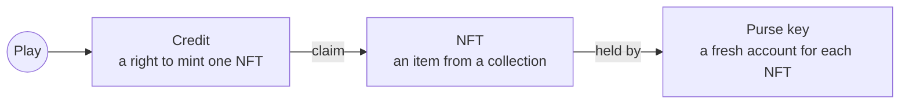
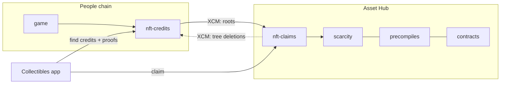
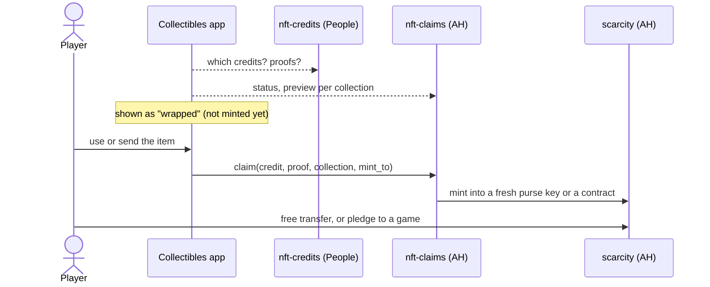
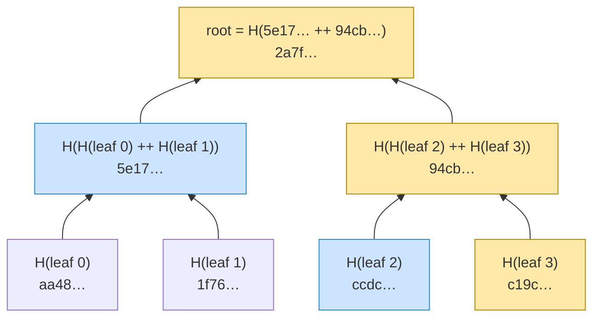
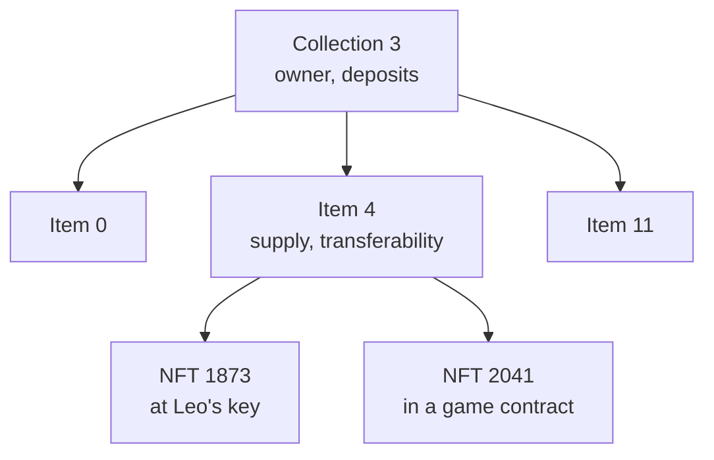
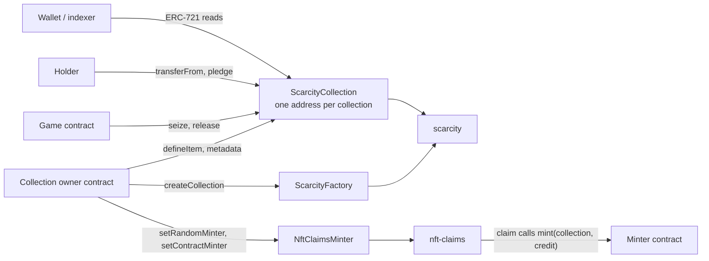
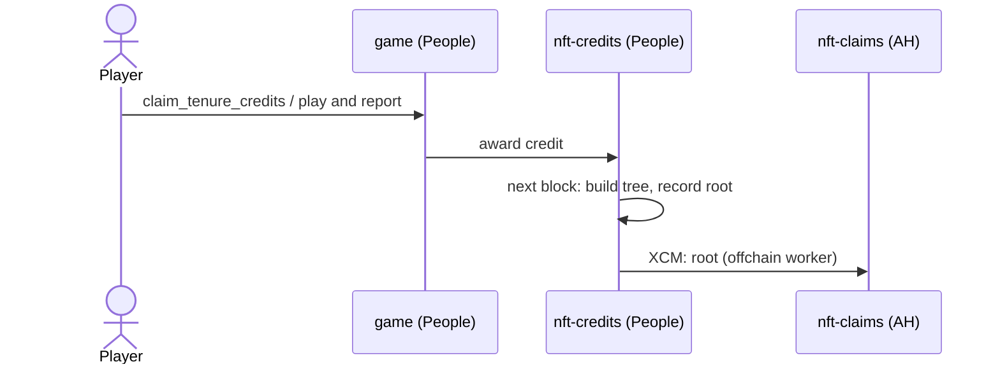
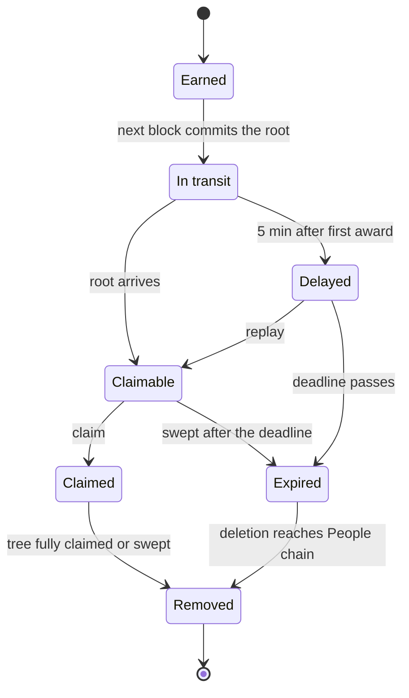

# Scarcity: from a game credit to an owned NFT

Technical overview of the NFT (Scarcity) stack, from product to storage.

---

## 1. Why it exists

**Problem.** Players of Jollity, the game in which people verify each other as unique persons, earn claim credits by playing. Before Scarcity, a credit was only a 32-byte hash on the People chain:

- It was bound to the player who earned it and could not be given to anyone else.
- The Jollity app only showed the credits.
- So nothing was owned, sent or used in a game.

**Goal.** Each game a player takes part in produces something they own and can transfer. This brings players back to the next game.

**Constraints that shape the design** (we return to these later):

- Minting and transfers need no gas purchase. Claims are paid in PGAS, which persons receive free each day.
- Exactly once: each credit mints one NFT. A failed mint leaves the credit unspent.
- Privacy: an observer cannot tell that two NFTs belong to the same player. Each NFT sits at its own account and is minted in its own transaction, never in a batch.
- The app renders a new collection from its on-chain metadata alone. No collection-specific code or app release is needed to display it. (At launch, the list of collections a player can pick from still ships in the app.)
- Data flows one way: People chain to Asset Hub. Only housekeeping (tree deletions) goes back.

---

## 2. The core idea



- You **earn credits** by playing, on the People chain.
- You **claim** a credit on Asset Hub to turn it into an **NFT**, from a collection you choose.
- Each NFT sits in its own **purse key**, so nobody can tell which NFTs belong together.

**We follow one credit through every layer: Mira's.** Mira is a recognised person who has attended 5 games. The tenure thresholds are 0, 1, 2, 4, 8 and 13 games, and she has reached every threshold ≤ 5: 0, 1, 2 and 4. So she earns 4 tenure credits in every game she signs up for, not once. In game **12** we follow the credit for **threshold 4**.

---

## 3. Big picture: two chains, one-way flow



A **root** is one hash that stands for all credits of a block; section 6 explains how. The **Collectibles app** is a single-page app that runs inside the Polkadot App and reads and signs through `product-sdk`. Its product requirements, user flows and design are documented in [paritytech/scarcity-spa](https://github.com/paritytech/scarcity-spa/tree/main/docs).

**Credits and NFTs are decoupled.**

| | Credit | NFT |
|---|---|---|
| Lives on | People chain | Asset Hub |
| Purpose | A right to mint one NFT | An owned token, transferable or soulbound per item |
| References a collection or item | No | Yes |
| Created by | Playing (game pallet) | Claiming a credit |

- The People chain knows nothing about collections or NFTs. It only commits to who earned which credit.
- Asset Hub never stores the credits themselves, only the roots. The claimant brings the credit and its proof.
- The player decides at claim time which collection the credit mints into.

---

## 4. The player journey: minting and using



**Why the app asks the People chain.** Asset Hub holds only the roots. To claim, the app needs data that only the People chain has:

- **Which credits exist and their state:** the blocks with Mira's credits, and whether each block's tree is pending, committed or removed.
- **The proof:** for each credit, the credit itself, its leaf position and the sibling hashes that `claim` needs.

Hold first: a credit stays claimable for 90 days from the first award in its tree, and until the next expiry sweep after that. "Wrapped" means the app shows an item that is not minted yet.

---

## 5. Earning credits: two kinds

| | Game credit | Tenure credit |
|---|---|---|
| Earned | Per group member, per round | Per tenure threshold: 0, 1, 2, 4, 8, 13 games |
| Paid | When another player confirms you as a person, or after the game if you attended | When claimed with `claim_tenure_credits` before the game |
| Hash of | Game, round, reporter, reported player | Game, threshold, player |

- Both paths compute the same game credit, so a report pays it early and attendance processing fills in the rest. A player who did not attend keeps only the reported ones.
- A person receives tenure credits at once while the credit buffers have room, and the rest during attendance processing. An account that is not a person receives them only after the game, and only if it attends.
- The hash makes each credit unique, so it is awarded once. The game pallet only calls `AwardCredits` and knows nothing else about NFTs.

> [!NOTE]
> **Mira's credit · step 1: earn**
>
> 4 tenure credits in game 12, one per threshold she reached. We follow threshold 4 (index 3):
>
> `blake2_256("polkadot-pop-tenure" ++ 12 ++ 3 ++ Mira's alias) = 0x0034ec8b…132c5a29`
>
> It is not an NFT yet: only a right to mint one. It has no collection until Mira picks one at claim time.

---

## 6. A Merkle tree

The People chain sends Asset Hub one hash per block instead of every credit. A Merkle tree makes that possible. Here is the tree of Mira's block, which holds her 4 credits:



- **Leaf:** `leaf = H(owner ++ credit)`. N is the leaf's position in the tree: leaves 0–3 hold Mira's credits for thresholds 0, 1, 2 and 4, with her game alias as owner. Only the owner can claim a leaf. The tree hashes each leaf once more, so its bottom row is `H(leaf N)`.
- **Root:** the hash at the top. Changing any leaf changes the root.
- **Proof:** the sibling hashes on the way from a leaf to the root (blue). With Mira's leaf 3 and these 2 hashes, Asset Hub recomputes the yellow path and compares the result to the root. It never sees the other credits.

`H` is `blake2_256`. With an odd number of nodes, the last one has no partner and moves up a level unchanged.

---

## 7. Committing and delivering (People chain)

**Committing.** At the start of every block (`on_initialize`), `nft-credits` builds one tree over the credits in the previous block's buffer and records its root. A block without credits gets no tree. A tree holds at most 2048 credits of one game; credits that do not fit, or belong to another game, spill into the buffers of later blocks.

**Delivering.** While roots are queued, the offchain worker submits a `send_credit_trees` transaction after every block. When that transaction is included, the XCM message goes out with up to 32 roots, or fewer if the channel's message size is the tighter limit. Every root has a sequence number, so Asset Hub notices a lost message. Nothing resends automatically: someone has to call `replay_credit_trees`, which anyone may do.

> [!NOTE]
> **Mira's credit · step 2: commit**
>
> Block 1,204,810 holds Mira's 4 credits, so its tree is the one on the previous slide. The People chain records `{ game 12, root 0x2a7f26d2…a129e0fc, 4 leaves, time }`. Only this record crosses to Asset Hub. Mira's credit stays on the People chain.

---

## 8. Claiming and minting (Asset Hub)

**`claim(claimant, block, credit, leaf_index, proof, collection, mint_to)`** in the `nft-claims` pallet

1. Resolve the claimant from the signer. `claimant` is a `ClaimantKind` that selects how: `Account` uses the signing account, and `Person` uses the alias the signing account is bound to.
2. Rebuild the leaf from the **authenticated** claimant. Someone else's credit hashes to a leaf that is in no tree.
3. Verify the proof against the stored root.
4. Mark the credit as spent.
5. Select the item (section 9) and mint it, **deposit-free**, into `mint_to`: a fresh purse key or a contract.

All steps run in one extrinsic: a failed mint leaves the credit unspent.

**Removal.** A tree is removed when all its credits are claimed, or by the expiry sweep after its deadline: 90 days from the tree's first award. A claim still succeeds after the deadline until the sweep runs. Credits left unclaimed then are destroyed. Asset Hub tells the People chain over XCM to drop its copy.

**No double mint.** Until the deadline, the record of spent credits outlives a fully claimed tree, so a resent tree cannot mint twice. The sweep then deletes that record, and a tree resent after its deadline is refused as stale.

**Privacy caveat.** For now, a claim links the signing account to every purse key it mints into. This holds for account and person claims alike, and a person's alias-to-account binding is already public in storage. Full unlinkability needs a ring proof at claim time.

---

> [!NOTE]
> **Mira's credit · step 3: claim (Asset Hub)**
>
> When Mira first sends the item, the app claims and sends in one go. The claim, signed by the account bound to her alias:
>
> ```rust
> // nft-claims pallet
> claim {
>     claimant: ClaimantKind::Person, // use the alias bound to the signer
>     block: 1204810,
>     credit: 0x0034ec8b…132c5a29,
>     leaf_index: 3,
>     proof: [
>         0xccdcb1db…a24330c8, // H(leaf 2)
>         0x5e17a993…9849a1ab, // H(H(leaf 0) ++ H(leaf 1))
>     ],
>     collection: 3,
>     mint_to: derive("//nft//1204810//3"), // purse key: a new account that holds only this NFT
> }
> ```
>
> **Purse key.** `mint_to` is a fresh key derived from Mira's seed and the credit's block and leaf.
>
> **Verification.** The pallet rebuilds Mira's leaf itself and rehashes it with the 2 siblings to `0x2a7f…e0fc`. That matches the stored root.
>
> **Forgery fails.** If Eve signs a claim with Mira's credit and proof, the pallet computes `H(Eve ++ credit)`. That leaf is not in the tree, so the proof does not reach the stored root.
>
> The credit is now spent. Which NFT she gets is the next slide.

---

## 9. Which item a claim mints: minter rules

The player picks the **collection**. The collection's **owner** (at launch, the team; later, outside creators) decides how a credit becomes an **item**. To accept claims at all, the owner opts in with `set_collection_minter` in the `nft-claims` pallet and picks one of two rules. Claims mint without a deposit, which grows the collection's supply, so this needs the owner's consent.

| Rule | Item minted |
|---|---|
| `Random` | No code needed. The first 4 bytes of the credit, read as a little-endian `u32`, modulo the collection's next item index. The same credit always gives the same item, as long as the items do not change. Deleted items still count, so a draw can land on one and fail. |
| `Contract` | The owner's contract answers `mint(uint32 collection, bytes32 credit)` with an item index, for example to apply rarity odds or supply caps. A revert refuses the claim, and the credit stays unspent. |

- A minter sets **rules**, not content: it returns an index into items the owner defined beforehand, and the look comes from item metadata.
- The credit is public and the claimant picks which one to spend, so a minter contract must not treat it as secret randomness.
- Before claiming, the app shows which item the credit would become in each collection. It gets this from the `preview_mints` runtime API, which runs each collection's rule without committing. One credit can be rare in one collection and common in another.

> [!NOTE]
> **Mira's credit · step 4: mint.** Collection 3 uses `Random`, and its next item index is 12. The first 4 bytes of her credit, `00 34 ec 8b`, read little-endian as `0x8bec3400 = 2347512832`, and `2347512832 % 12 = 4`, so item 4 is minted as NFT **1873**. NFT ids come from one counter across all collections: each mint takes the next id, and ids are never reused.

---

## 10. Minting stages: claimable in about a minute

These stages describe the process. The chain does not store a stage per credit: a client derives it from two runtime APIs (appendix D).

| Stage | Chain | What happens | Trigger |
|---|---|---|---|
| 1. Earned | People | `game` awards a credit to a block | `report`, attendance, `claim_tenure_credits` |
| 2. Committed | People | The next block builds the tree and records its root | `on_initialize` |
| 3. Sent | People | The offchain worker sends the root to Asset Hub | Offchain worker, with retries |
| 4. Claimable | Asset Hub | `nft-claims` stores the root | XCM arrives |
| 5. Claimed | Asset Hub | The claim spends the credit and mints the NFT | Signed `claim` |
| 6. Removed | Both | Tree removed when fully claimed or expired | Last claim, expiry sweep |

- A credit is identified by `(block, leaf_index)`, the same pair a `claim` names.
- On the devnets ([nft-minting.md](./nft-minting.md)) a credit was claimable within about a minute. **The user is the slow step:** the first claim of a tree came from 1 minute to 18 days after it arrived.

> [!NOTE]
> **Mira's credit · what her app shows over time**
>
> | Time (UTC) | People | Asset Hub | Stage shown |
> |---|---|---|---|
> | 2026-11-20 17:58:12 | `Pending` | | Earned |
> | 17:58:18 | `Committed` | `NotStored` | In transit |
> | 17:58:54 | `Committed` | `Claimable` | Claimable until 2027-02-18 |
> | 2026-11-22 09:14 (first send: claim, then transfer) | `Committed` | `Claimed` | Claimed |

---

## 11. Ownership and free transfers

The `scarcity` pallet is the NFT ledger. It records every NFT and which account holds it.

**One NFT per purse key.**

- A purse key is a throwaway account. A fresh key per NFT keeps a player's NFTs unlinkable.
- A contract is the exception and can hold many NFTs (section 15).

**Free transfers.** The `AsScarcity` transaction extension lets a purse key move its NFT without a fee or a balance. As spam protection, a recently moved NFT gets lower priority, and each NFT has at most 16 free moves. After that the holder needs a paid move (`transfer_by_holder`), which refills them.

**Transferable or soulbound**, fixed per item:

- **Transferable:** the holder can send the NFT to anyone.
- **Soulbound:** the holder cannot move the NFT, for example an achievement. The holder can still burn it, and the collection owner can still force-move or force-burn it.

**Burning.** A purse-key holder can burn their own NFT; a contract has no holder burn. Combining several commons into one rare is a pattern, not a protocol feature: the player burns the commons, then the collection owner (or its contract) mints the rare item in a separate call.

---

> [!NOTE]
> **Mira's credit · step 5: send (Asset Hub)**
>
> Right after the claim, Mira's purse key holds:
>
> ```rust
> Nft { instance: 1873, collection: 3, item: 4,
>       minted_at: 1795338840, last_moved: 1795338840, // 2026-11-22 09:14:00
>       state_nonce: 0, moves: 0 }
> ```
>
> In the next block the send completes: Leo's app supplies a fresh key, and a free transfer signed by Mira's purse key moves the NFT. After the move, Leo's key holds:
>
> ```rust
> Nft { instance: 1873, collection: 3, item: 4,
>       minted_at: 1795338840, last_moved: 1795338846, // 09:14:06, priority restarts from zero
>       state_nonce: 1,  // the old signature is used up
>       moves: 1 }       // one of 16 free moves spent
> ```
>
> Nothing on chain connects Mira's key to the 3 other NFTs she earned.

---

## 12. What is stored

A **collection** defines **items** (the catalogue), and each mint creates an **NFT** of an item.



| Level | Stored | Metadata |
|---|---|---|
| Collection | Owner, item count, deposits | Defaults for every item, for example `name`, `symbol` |
| Item | Supply (NFTs minted so far, not a cap), transferable or soulbound | Defaults for every NFT, for example `tokenURI`, rarity, game stats |
| NFT | Id, collection, item, mint time, transfer counters, its holder | Overrides for one token |

- Metadata keys and values are raw bytes. A nearer scope overrides a farther one.
- Reserved keys feed the ERC-721 view: `name`, `symbol`, `contractURI` and royalties from the collection scope only, `tokenURI` from the NFT, then the item.
- Artwork lives off-chain: flat images plus depth and material maps, rendered in 2.5D, 2D or 3D. `tokenURI` points to it.
- Not stored: credits, game data, who earned an NFT, prices.

---

## 13. Creating a collection

**On chain, anyone can create a collection** by paying a storage deposit. The signer becomes the owner.

| # | Pallet | Call | What it sets |
|---|---|---|---|
| 1 | `scarcity` | `create_collection()` | New collection, owned by the signer |
| 2 | `scarcity` | `set_collection_metadata(collection, key, Some(value))`, once per key | `name`, `symbol`, royalties and other defaults |
| 3 | | Off-chain: upload artwork and manifests | The files that `tokenURI` points to |
| 4 | `scarcity` | `define_item(collection, transferability, metadata)`, once per item | Items 0, 1, 2 …, each `Transferable` or `Soulbound`, with artwork link and rarity |
| 5 | `nft-claims` | `set_collection_minter(collection, Some(selection))` | Opts in to claims with `Random` or `Contract(address)` (section 9). `None` opts out. |
| 6 | | Get listed in the Collectibles app | Players can now pick it |

**The owner has full control:** they can change metadata, force-transfer and burn any NFT, and change the minter. Players therefore trust the collection owner.

**Who decides which collections players see:**

- **At launch:** Applied Engineering (the Jollity Taskforce and the Collectibles squad). The app ships the list.
- **Later:** outside creators, after an approval process that is not defined yet.

---

## 14. Precompiles: the contract-facing surface

Contracts on Asset Hub (`pallet-revive`) cannot call pallets directly. They use three precompiles:



- **ScarcityCollection:** each collection answers the ERC-721 interface. Read-only views (`ownerOf`, `balanceOf`, `tokenURI`) work as-is in wallets and indexers. Writes differ: `approve` and `setApprovalForAll` always revert, `transferFrom` works only when the caller is the holder, and `safeTransferFrom` into a contract reverts. A marketplace holds the item in escrow or takes a pledge instead.
- **ScarcityFactory:** creates a collection. The caller pays the storage deposit and becomes the owner.
- **NftClaimsMinter:** the collection owner picks the claim rule: `Random` or a minter contract.

---

## 15. Contracts and game use

A game needs to hold or take players' NFTs. A purse key holds only one, so contracts get two extra abilities.

**Contracts hold many NFTs.**

- A contract can receive, hold and send out any number of NFTs. Claims can mint straight into a contract.
- Use: a game contract holds the items players stake in a match.
- An arriving NFT does not record its sender, so the contract has to record who staked.

**Pledges.**

- The **holder** calls `pledge(tokenId, pledgee, until)`, natively and fee-less or through the precompile. It gives the pledgee, for example a game contract, the right to seize the NFT until `until`, at most 30 days ahead.
- The NFT stays at the holder's key. Until `until` the holder cannot move or burn it, and cannot revoke the pledge.
- The pledgee can `seize` the NFT into an empty key or `release` it. It can also name a delegate (`setDelegate`) that seizes fee-less with its own key, for example the winner of a match.
- The pledge lapses by itself at `until`. Any move clears it, including the collection owner's force-transfer and force-burn, which ignore pledges.
- A pledge is not an approval: the pledgee cannot call `transferFrom`. Contracts read it with `pledgeOf`.
- Use: a player stakes an item without handing it over. The game seizes it, for example if the player loses, and otherwise releases it.

---

> [!NOTE]
> **Mira's credit · step 6: render**
>
> | Key | Collection 3 | Item 4 | NFT 1873 | Result |
> |---|---|---|---|---|
> | `name` | `Tenure Relics` | `Lantern of Four` | | `Lantern of Four` |
> | `rarity` | | `rare` | | `rare` |
> | `power` | | `40` | `55` | `55` (NFT override: the game, as collection owner, levelled it up from 40) |
>
> A standard ERC-721 wallet sees less: `name()` reads only the collection scope, so it shows "Tenure Relics", and `tokenURI(1873)` resolves to item 4's artwork. `rarity` and `power` are not in the ERC-721 view; only the precompile's own `instanceMetadata` resolves NFT → item → collection. `ownerOf(1873)` returns Leo's key address.

---

## 16. Guarantees

Back to the five constraints from section 1:

| Constraint | How |
|---|---|
| Free | Claims are paid in PGAS, which persons receive free each day. Transfers are fee-less, up to 16 per NFT before a paid move. |
| Exactly once | Spent credits are recorded until the tree's deadline, and a tree resent after it is refused as stale. Check, spend and mint run in one extrinsic, so a failed mint rolls back. |
| Private | One NFT per purse key (v1: the claiming account links its purse keys) |
| Self-describing | Three metadata scopes, reserved keys and the ERC-721 view |
| One-way | Only roots cross to Asset Hub; only tree deletions go back |

Also:

- **Delivery is recoverable:** overflow goes to later trees. A lost message is detected, and anyone can resend it with `replay_credit_trees`. Credits unclaimed at the deadline are destroyed.

---

## 17. Open questions

- **Anonymous claims:** a claim links the signing account to every purse key it mints into. Removing that link needs a ring proof at claim time.
- **Rarity across collections:** each collection sets rarity its own way, so the app cannot compare or sort rarity between collections yet.
- **Third-party collections:** the approval process for an outside creator's collection is not decided.

---

# Appendix

---

## A. The player journey: earning



---

## B. Pallets

| Chain | Pallet | Role |
|---|---|---|
| People | `game` | Awards credits: `report`, attendance processing, `claim_tenure_credits` |
| People | `score` | Counts tenure: games attended while recognised as a person |
| People | `nft-credits` | Holds awards, builds one tree per block, sends roots over XCM, serves proofs |
| Asset Hub | `nft-claims` | Stores roots, verifies proofs, records spent credits, registers collection minters, expires old trees |
| Asset Hub | `scarcity` | Stores collections, items, NFTs and metadata. Makes transfers free (`AsScarcity`) |
| Asset Hub | `pgas` | Gives each recognised person a free daily PGAS allowance, which pays claim fees. A failed claim still costs its fee. |

---

## C. When credits arrive during a game

Tenure credits arrive when a person claims them before the game, game credits with each report, and the rest during attendance processing. [nft-minting.md: Award phases](./nft-minting.md#award-phases) describes each phase and how a wallet tells from `Game::Game` whether more credits can arrive.

---

## D. Tracking a credit

The chain does not store a stage per credit. A client derives it from two runtime APIs, `nft_claim_credit_blocks` on the People chain and `credit_statuses` on Asset Hub, and the current time. The reference implementation is [`examples/lib/nft-status.ts`](./examples/lib/nft-status.ts).

Stages as a client derives them:



[nft-minting.md](./nft-minting.md) lists the chain states, the runtime APIs, how a client maps them to a stage, and the events of each stage: see [Tracking with runtime APIs](./nft-minting.md#tracking-with-runtime-apis) and [Tracking with events](./nft-minting.md#tracking-with-events).

Examples: [`examples/nft_minting.ts`](./examples/nft_minting.ts), [`examples/nft_status.ts`](./examples/nft_status.ts).

---

## E. Selling NFTs: what a marketplace contract calls

A trustless marketplace on Asset Hub is a smart contract on `pallet-revive`, so it needs the precompiles:

| Marketplace step | Precompile call |
|---|---|
| Show listings and their art | `ownerOf`, `tokenURI`, `name`, `symbol` |
| Pay the creator a royalty | ERC-2981 `royaltyInfo` |
| Hold the item while it is listed | The seller transfers it into the marketplace contract |
| Settle the sale | The marketplace calls `transferFrom` to the buyer |
| Alternative to escrow | A pledge: the item stays with the seller, and the marketplace can `seize` it on sale |

A marketplace that settles off-chain, or a native pallet, would not need the precompiles. The marketplace is a separate app and its design is open.

---

## F. Mira's credit, end to end

| Layer | Chain | What exists | Value |
|---|---|---|---|
| Game | People | Tenure claim for game 12, tenure 5 | threshold index 3 |
| Credit | People | `blake2_256(prefix ++ game ++ index ++ claimant)` | `0x0034ec8b…132c5a29` |
| Leaf | People | `blake2_256(claimant ++ credit)`, position 3 of 4 | `0x9fd0cb84…b71e694b` |
| Root | People → AH | Tree record for block 1,204,810 | `0x2a7f26d2…a129e0fc` |
| Proof | App | 2 sibling hashes: `H(leaf 2)`, `H(H(leaf 0) ++ H(leaf 1))` | `ccdc…`, `5e17…` |
| Claim | AH | Credit marked spent, `Random` draw | item `2347512832 % 12 = 4` |
| NFT | AH | `Nft { instance: 1873, collection: 3, item: 4, … }` | at a fresh purse key (client convention; the chain enforces one NFT per key at a time) |
| Metadata | AH | collection → item → NFT | "Lantern of Four", rare |
